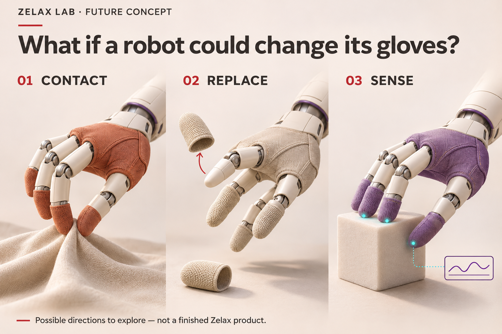

# Zelax Robotics

### What if a robot could change its gloves?

A place to explore coverings, contact surfaces and sensing interfaces for robotic hands—part of [Zelax Lab](https://lab.zelax.com).

*AI-generated concept illustration. The pictured designs and sensing indicators are ideas to discuss, not tested products or real measurements.*

**Current stage: concepts and documentation.** This repository starts with research questions, an experiment template and a way to contribute. No robot hardware, software, datasets or validated performance results have been released here yet.

## Three directions to explore

| Direction | The everyday question | What we could investigate |
| --- | --- | --- |
| **Contact** | What should the hand feel against an object? | Textures, thickness, flexible sections, holding and releasing. |
| **Replace** | Could we change only the part that wears? | Fingertip sleeves, palm panels, fit, wear and maintenance. |
| **Sense** | What information would help the hand do its task? | Coverings around existing sensors, possible sensor placement and the effect of different materials. |

Start with [the research directions](docs/research-directions.md). Each begins with a small, practical question.

## Begin with one task

A useful contribution can start with an object: a piece of cloth, a container or a small component. What makes it difficult to pick up, hold or release?

1. **Discuss the idea** in [Sensing and robotics at Zelax Lab](https://lab.zelax.com/c/sensing-and-robotics/8).
2. **Make the question specific** with the [experiment template](docs/experiment-template.md).
3. **Share a proposal** through a [GitHub issue](https://github.com/zelaxcom/zelax-robotics/issues/new/choose), or suggest a documentation change in a pull request.

You can contribute observations, sketches or material ideas without owning a robot. If you do run an experiment, include the method and the unsuccessful attempts as well as the promising ones.

## What belongs where?

**Zelax Lab** is the place for conversation, visual ideas and questions from the wider community.

**This repository** is a place for organized technical notes and contributions that can be reviewed and revised. Future code, designs or datasets can be added when they are ready to share, with their status and license stated alongside them.

## Explore this repository

- [Research directions](docs/research-directions.md) — contact, replacement and sensing questions.
- [Experiment template](docs/experiment-template.md) — a consistent way to describe a test and its limits.
- [Contributing](CONTRIBUTING.md) — how to propose an idea or improve a document.

---

[Visit Zelax Lab](https://lab.zelax.com) · [Join the robotics conversation](https://lab.zelax.com/c/sensing-and-robotics/8) · [Contact the Lab](mailto:lab@zelax.com)
